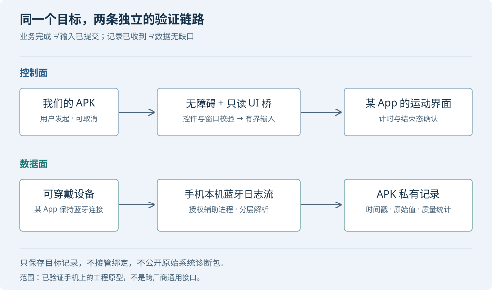

# 免 root 采集可穿戴设备心率：一次 Android 工程闭环

一副可穿戴设备能在配套 App 的运动界面显示心率，能否让另一个 APK 也获得这些数据？最初看起来像一个蓝牙协议问题，最后却主要是权限、页面控制、生命周期和数据质量的工程问题。

目标不是接管整套设备协议，而是完成这个流程：**自己的 APK 发起运动 → 某 App 的运动界面确认开始 → 回到自己的 APK 采集 → 控制结束 → 自动保存带时间戳的心率记录。**

为保护项目与个人信息，下文统一使用“某 App”“可穿戴设备”“测试手机”。不提供厂商、包名、账号、设备标识、绑定材料、原始蓝牙抓包或个人心率明细。示例程序使用合成数据。

!!! summary "先说结论"
    在一台已验证的 Android 手机上，保留某 App 的蓝牙连接，通过 Shizuku 提供的授权 shell 辅助进程读取本机蓝牙调试日志流，用无障碍执行经控件树定位的运动控制，最终完成了免 root、拔掉 USB 后的手机独立采集闭环。现场还验证了约三分钟锁屏期间的采集与结束后保存。

    这不等于普通 APK 已能直接连设备获取心率，不等于所有手机都开放同一个端口，也不代表数据连续、严格 1 Hz 或具有医疗准确性。

## 1. 蓝牙连上，不代表业务数据拿到了

分析设备时，容易把三件事当成一件事：

1. 与设备建立传输连接；
2. 通过业务握手、绑定与会话校验；
3. 正确发出业务命令，并收到测量结果。

实验中，一个独立原型曾收到命令 ACK，但没有实际测量提示，也没有对应心率结果。ACK 只能说明某一层收到了消息，不能证明眼镜已开始测量。这条经验后来也用于 UI 自动化：**触控完成，不是运动开始；页面出现，不是数据完整。**

几条候选路线的边界如下。

| 路线 | 实验中遇到的边界 | 能得出的结论 |
|---|---|---|
| 独立 APK 直接连接设备 | 业务握手与绑定流程没有完成独立复现 | 不能因为传输连接成功，就宣称业务可用 |
| 订阅某 App 的对外 IPC | 已找到的导出接口未提供所需心率订阅 | 对这版接口的验证失败，不代表所有版本不存在接口 |
| 改包后增加转发 | 重签出现启动与登录链路问题 | 对本次原型而言成本高，不适合作为稳定基础 |
| 读取运动界面 | 前后台窗口和渲染生命周期需要单独验证 | 能看见某页，不等于真后台仍可稳定读取 |
| 保留原连接，解析本机日志 | 测试手机存在可用日志流，能够解析目标运动记录 | 获得了一条可落地路径，但依赖机型与系统配置 |

不再尝试替换某 App 的所有职责，是这个项目的重要转折。它继续负责设备绑定、连接和运动业务；原型只承担有限的控制、观察和保存职责。

## 2. 最终架构：把控制面与数据面分开



**控制面**负责“运动有没有真的开始或结束”：

- 无障碍服务执行用户请求的有限导航与触控；
- Shizuku 的只读 UI 桥取得当前窗口的控件快照；
- 状态机根据页面与计时变化确认业务结果。

**数据面**负责“哪些记录确实收到了”：

- 另一个 Shizuku 辅助进程连接固定本机日志出口；
- 增量解析蓝牙帧与目标业务消息；
- 只把目标运动记录交回 APK，写入应用私有目录；
- 结束确认后短暂收尾，按本场时间范围保存 CSV 和统计。

两个平面有独立状态。运动可能还在进行，而日志接收已经失败；日志也可能仍在接收，但结束操作尚未确认。不能用一个“采集中”标签掩盖这些差别。

### Shizuku 和无障碍分别做什么

Shizuku 不是 root，也不是“安装后自动提权”。它让获授权的应用调用以 ADB shell 身份运行的辅助服务。本原型使用它读取本机日志流和可靠的窗口快照。无障碍服务则负责有限、可取消的输入动作。[Shizuku 手册](https://shizuku.rikka.app/zh-hans/guide/setup/)

当前实现主动要求辅助服务运行在 shell UID。**普通应用 UID 是否也能直接读取这个端口，尚未单独验证**；不能据此声称端口一定需要 Shizuku，也不能声称现在就可以去掉它。

## 3. 从完整诊断包，转向本机流式出口

最早的离线路线是生成系统诊断包，再从里面提取蓝牙日志。它有两个问题：等待慢，以及采集范围过大——完整诊断包可能包含其他应用的系统信息。

后来，在测试手机上发现了本机 `127.0.0.1:8872` 的 btsnoop TCP 流。确认它由手机的蓝牙进程监听，而不是电脑上的转发代理后，才把它接入 APK。

AOSP 有 `btsnoop_net` 的历史实现与说明：在相应构建和日志配置下，蓝牙栈可以通过本地 TCP 暴露日志。**它是调试能力，不是跨厂商承诺的公开 Android 数据接口。** 开启 HCI 日志，也不意味着任何手机一定出现这个端口。[AOSP 说明](https://android.googlesource.com/platform/system/bt/+/ea7ab70a711e642653dd5922b83aa04a53af9e0e/doc/btsnoop_net.md)

生产化前，至少应检查：

- 连接的是固定 loopback 地址，不接受外部传入的任意主机和端口；
- 16 字节文件头、版本与链路类型正确；
- 后续确实收到结构有效的帧，而不是只判断 socket 已建立；
- 目标方向、通道、事件类别与负载结构都匹配；
- 接收时长、字节数、包数、待重组缓存都有上限；
- 只保存目标数据，不把整条蓝牙流写入公开目录或上传。

完整诊断包可以保留为另行授权的排障工具，但不应在快速路径失败时偷偷自动兜底。

## 4. 中途开始监听，为什么会“有流、没记录”

即使拿到有效日志，旧解析器仍一度返回零条记录。关键不是“有没有字节”，而是**监听开始时，连接已经进行到哪一层**。

一个完整解析过程可能包含：

```text
btsnoop 记录边界
  → HCI ACL 分片
  → L2CAP / CoC 重组
  → 业务协议帧、分片与校验
  → 目标事件
  → 运动记录字段与时间戳
```

如果蓝牙连接早已建立，日志从中途接入，前面的通道协商可能不在录制范围内。严格依赖“亲眼见到协商”的解析器，会漏掉后面实际存在的业务记录。

本次用**同一份录制**进行对照：严格解析器返回零条，有限的中途恢复策略提取到了目标记录。这证明“缺少早期协商”能够造成该失败；它并不能解释此前所有零记录实验。

恢复不能退化成“在字节里搜到像心率的数字就接受”。做法是先限定已知入站帧形状，再继续执行完整长度、重组、校验和业务结构验证。统计也必须区分：

- **已观察协商的通道**；
- **依据已知帧结构推断的通道**。

把两者合并成一个“已连接通道数”，会制造并不存在的握手证据。

此外，TCP 分块没有业务含义。一次 `read()` 可能只给半个文件头，也可能包含多个包。解析器需要跨读取保留未完成片段；不能把每次读取当成一条完整消息。

## 5. 控件树定位，也不等于触控绝对安全

本次没有把 OCR 作为首选。优先使用控件文字、类、可见性、边界和相邻结构寻找唯一目标。但这并不意味着所有动作都是语义 `ACTION_CLICK`：部分目标最终仍通过触控交付，因此会受窗口变化影响。

### 旧窗口字段会污染当前控件树

某些页面中，原生根窗口已更新，而部分嵌入式子节点仍报告旧窗口 ID。按子节点的旧 ID 查询后续节点，会得到残缺、旧树或空结果。

修复原则是：以**当前官方根窗口**作为查询路由，验证节点身份、窗口稳定性和快照时效，不把曾经成功的窗口 ID 写死。

### 通知浮层会截走控件中心的点击

另一类真实故障是：控件定位正确，但发送触控时通知正好盖住顶部标签，点击落进通知。

仅检查“某 App 仍有焦点”不够。非焦点的通知也能覆盖坐标区域。应在输入前重新核对窗口层级、焦点和触控路径上的遮挡；窗口变化后等待稳定，发现遮挡就停止，而不是自动点开或关闭通知。

这种检查与触控提交不是原子操作。通知若在触控提交后出现，仍可能接收已经发出的输入。工程上需要记录“结果未确认”，禁止盲目重试，而不是承诺绝无误触。

## 6. 成功要验证，失败也必须有出口

运动控制采用有界状态机，而不是“点击 → sleep → 再点击”的固定脚本。

| 场景 | 判定与处理 |
|---|---|
| 尚未发送 GO 就失败 | 明确本次未发送开始操作；排除问题后可重试 |
| GO 已发送，未见新运动计时更新 | 状态未确认，禁用重复开始，允许只读核对 |
| 新运动页及计时前进均确认 | 才记录本场开始已验证 |
| 暂停／结束输入已发送 | 不立即宣告结束，继续观察明确结束态 |
| 稳定回到可启动页且无进行中面板 | 才确认 UI 已结束 |
| 结束失败 | 保留本地场次，状态未确认，不伪造结束时间 |
| 用户手动切回原型 | 取消后续自动输入，显示最近结果与可用操作 |
| 读取或整体流程超时 | 停止操作、保存原因，尝试返回原型 |

开始后观察计时前进，可以避免把静止文字或旧运动记录误判成新场次。结束则要求明确提示，或稳定的可启动状态；空白树不是结束证据。

定位错误也不应只匹配一条固定文案。“GPS 权限未开启”“请开启 GPS”“定位失败”需要归入可识别的错误类别，但**不能把它们都诊断成权限未授权**。系统开关、信号和 App 内部条件都可能参与其中。

失败后的界面至少要回答三件事：发生了什么、运动状态是否已确认、下一步可以点什么。自动返回被锁屏或系统策略拒绝时，也应把错误保留到用户下次打开，而不是永远显示“操作中”。

## 7. 原始零值、时间戳与“1 Hz”的误区

蓝牙消息里的时间戳和数值进入 CSV 后，还需要建立数据质量口径。

### 三种时间不要混用

- **设备记录时间**：业务负载中的采样／记录时间。
- **HCI 时间**：蓝牙日志给这一批传输记录的时间。
- **APK 处理时间**：应用实际解析、收到回调或落盘的时间。

本原型导出中的 `arrivalUnixMs` 实际来自 HCI 时间，命名容易让人误以为它是 APK 处理时间。分析时必须明确这一点：不能仅用该列证明熄屏时 APK 正在逐条实时执行，也不能用它反推出锁屏时刻。

按“手机开始命令 → 手机结束确认”的窗口筛选设备记录，是一个实用关联方法，但两套时钟未独立对齐，且未匹配官方运动记录 ID，不能把这种筛选叫作精确的业务会话认证。

### 零值不补成正常心率，长间隔不直接叫丢包

原始零值不是“真实心率为零”，也不是应该用前一个正常值填掉的噪声。图表将它标为原始零值，并断开曲线。重复时间戳同样保留，不静默去重。

本次两场独立实验的聚合结果如下。它们持续时间、操作条件不同，**不是同场新旧方案的性能对照**。

| 场景 | 原始记录 | 非零记录 | 原始零值 | 正时间间隔中位数 | 最大记录间隔 |
|---|---:|---:|---:|---:|---:|
| 手机内亮屏闭环 | 95 | 77 | 18 | 1.004 秒 | 4.123 秒 |
| 用户拔线、约三分钟锁屏后闭环 | 158 | 138 | 20 | 1.010 秒 | 7.093 秒 |

两场的零值均集中在开头。后一场出现 5 个超过 3.030 秒的记录间隔，不能把“中位数约一秒”写成“连续严格 1 Hz”。最大间隔的两端记录具有相同 HCI 时间，有同批上报的特征；这也不能单独确定稀疏记录产生于设备、蓝牙、系统省电还是解析链路。

锁屏由用户现场操作并报告，结束后 CSV 经独立读回核对；没有精确锁屏／解锁标记，也没有同时覆盖全链路的独立原始流对照。因此该实验支持本机短时锁屏采集可用，不证明长期稳定、绝无丢点或医疗准确性。

可用一个简单规则提示长间隔：

$$
\Delta t_i=t_i-t_{i-1},\qquad
\tau=\max\bigl(3\,\mathrm{s},\;3\,\mathrm{median}(\Delta t_i>0)\bigr).
$$

这个阈值是排查线索，不是协议规定，更不是丢包率估计器。[合成数据的质量检查示例](examples/quality_check.py) 演示如何分别报告零值、重复时间和正间隔，不插值、不补点。

## 8. 拔掉 USB 后，什么还在依赖调试配置

如果日志出口确实在手机本机，解析与保存也在手机里，USB 就不应成为运行时数据通道。但 Shizuku 必须先启动，不能把“无需持续接电脑”误解为“无需首次配置”。

Android 11 及以上支持通过手机无线调试配对和启动 Shizuku。非 root 方式重启后需要重新启动服务；服务停止与配对丢失是两件事，不能每次都要求用户删除后重新配对。[Shizuku 官方流程](https://shizuku.rikka.app/zh-hans/guide/setup/)

本次无线配对有一个容易误诊的现象：通知其实存在，只是位于通知列表较下方。展开后最初只有“正在搜索配对服务”；允许后台运行并重新触发流程后，才出现“已找到配对服务”和“输入配对码”。

这不构成后台省电是唯一原因的证明——同时发生了设置调整与搜索重启。正确记录是“这条组合流程成功”，而不是编造确定根因。

配对成功后，在手机端点击无线启动，再拔掉 USB 完成采集闭环，才能支持独立运行结论。电脑执行启动脚本成功，不能替代这个验收。

## 9. 迁移到另一台手机前，先做能力探测

不要把“测试手机可用”包装成“安装即可适配任意 Android”。迁移时逐项核验：

- [ ] 某 App 已登录，设备已连接并佩戴；
- [ ] HCI 日志配置正确，本机日志出口确实存在；
- [ ] 授权辅助进程能读取有效帧，而不只是连上端口；
- [ ] 运动消息能通过方向、通道和负载结构校验；
- [ ] 页面控件、窗口路由与业务成功判据仍适用；
- [ ] 无障碍和 Shizuku 已由用户授权，后台策略允许持续工作；
- [ ] 拔线、锁屏、结束保存、重启后恢复分别有验证记录。

一个安装文件可以引导安装依赖，但不能因此静默获得调试权限、无障碍权限或 shell 身份。安装体验、首次配置和运行时稳定性是三个不同问题。

## 10. 真正可复用的经验

这次项目最值得保留的不是某个字段偏移或某次成功截图，而是几条判断规则：

1. **把业务控制与数据接收分开建模。** 任一侧出错，都要能说清另一侧的状态。
2. **每一层只声明自己验证过的事实。** ACK、触控回调、页面计时和数据完整性不能互相替代。
3. **中途监听要处理状态缺失。** 可以有限恢复，但必须保留推断与实测的区别。
4. **让失败收敛，而不是让用户猜。** 错误要持久化，重试要有条件，未知状态不能被成功界面遮住。
5. **先保留原始质量，再讨论平滑展示。** 零值、重复和间隔是证据，不是为了曲线好看就该抹掉的东西。

下一轮验证应记录手机处理时间与锁屏标记，并对同一场运动做独立来源对照，再开展更长时间和更多机型的测试。没有这些证据之前，原型可以说“在已验证条件下可用”，不应说“普遍可靠”。
